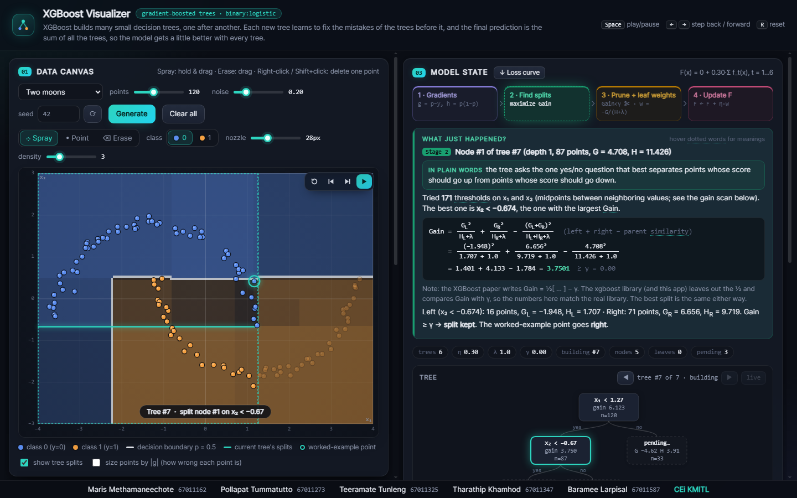

# XGBoost Visualizer

An interactive, step-by-step visualizer of **XGBoost** (gradient-boosted decision trees) for beginners. Every step shows the real formula with the real numbers plugged in.

**▶ Try it:** https://potumma.github.io/xgboost-visualizer/

## What is XGBoost?

XGBoost builds many small decision trees, one after another. Each new tree learns to fix the mistakes of the trees before it, and the final prediction is the sum of all the trees.

One boosting round has 4 stages, and the app lets you step through each one:

1. **Gradients**: every point says how wrong it is. `g = p − y` gives the direction of the error and `h = p(1 − p)` how much to trust it.
2. **Find splits**: the tree tries every threshold on x₁ and x₂ and keeps the one with the highest **Gain**.
3. **Prune + leaf weights**: splits with Gain < γ are removed, and each leaf gets its best value `w = −G / (H + λ)`.
4. **Update**: every point's score moves by `η · w`, so the loss goes down.

## How to use

| Action | How |
|---|---|
| Make data | Pick a shape (moons, circles, XOR, spirals…) and press **Generate**, or **Spray** points on the canvas |
| Edit data | **Point** adds one point, **Erase** removes points under the nozzle, right-click deletes one point |
| Run one step | **Step** button or <kbd>→</kbd> |
| Go back one step | **◂ Back** button or <kbd>←</kbd> |
| Train to the end | **Play until convergence** or <kbd>Space</kbd> |
| Start over | **Reset model** or <kbd>R</kbd> |
| Learn the words | Hover any dotted word in the explanation box |
| Explore a tree | Hover a tree node to highlight its region on the canvas; use ◀ ▶ to browse past trees |

Training stops when the loss improves by less than ε, or when it reaches `n_estimators` trees.

## Features

- **Data canvas** showing decision regions, the p = 0.5 boundary and the current tree's splits, updated live
- **Model state**: the 4-stage pipeline, a "What just happened?" box with worked formulas, the tree diagram, a gain chart for every threshold, and a per-point table (F, p, g, h)
- **Loss curve** of training log-loss after each tree
- **Hyperparameters** named as in the XGBoost library: `n_estimators`, `learning_rate`, `max_depth`, `reg_lambda`, `gamma`, `min_child_weight`
- Single `index.html` file with no libraries. It works offline and on phones.

## Is the math correct?

Yes. We verified it against the **official XGBoost library (v3.2.0)**. With the same data and settings (`tree_method="exact"`, `base_score=0.5`), the training loss matched after every tree, to 7 decimal places, across 49 test runs covering 8 datasets and different values of η, depth, λ, γ and min_child_weight.

You can also check it yourself: open the browser console (F12) and run `runSelfTest()`. It checks one tree against a hand-calculated example.

## Team

CEi KMITL

| Student ID | Name |
|---|---|
| 67011162 | Maris Methamaneechote |
| 67011273 | Pollapat Tummatutto |
| 67011325 | Teeramate Tunleng |
| 67011347 | Tharathip Khamhod |
| 67011587 | Baramee Larpisal |
